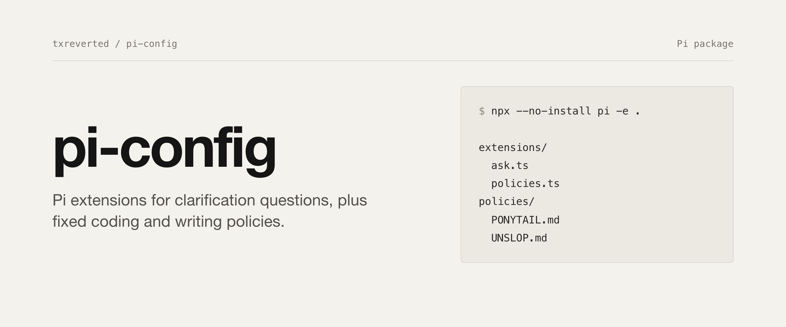

<p align="center"></p>

# pi-config

A [Pi](https://github.com/earendil-works/pi-mono) package that adds an `ask_user_question` tool and appends fixed coding and writing policies to every system prompt. It uses Pi's own interface and built-in providers.

## Use

Requires Node.js 22.19.0 or newer. From a checkout:

```sh
npm ci --ignore-scripts
npx --no-install pi -e .
```

In Pi, run `/login` to pick a provider, then `/model` to pick a model. Credentials stay in Pi's own `~/.pi/agent/auth.json`; never put them in this repo. Extensions run with your permissions, and the policies guide the model without restricting shell, file, network or Git access.

- [`extensions/ask.ts`](extensions/ask.ts): `ask_user_question` asks 1–4 multiple-choice questions with an `Other` free-text answer (2,000-byte limit). Works in TUI and RPC sessions only.
- [`extensions/policies.ts`](extensions/policies.ts): on each `before_agent_start`, appends [`policies/PONYTAIL.md`](policies/PONYTAIL.md) (coding: reuse first, root-cause fixes, smallest complete diff) and [`policies/UNSLOP.md`](policies/UNSLOP.md) (writing style). No settings or off switch; edit the Markdown to change them.

The policies adapt [DietrichGebert/ponytail](https://github.com/DietrichGebert/ponytail/blob/e3ba2aa6f1e6f0bc4d69eb09c9f0d0a93af56156/skills/ponytail/SKILL.md) and [cursor/plugins](https://github.com/cursor/plugins/blob/c1c0a32802223f4be824112dd83d33ad29a8b26c/pstack/skills/unslop/SKILL.md). Notices: [`ponytail.LICENSE`](policies/ponytail.LICENSE), [`unslop.LICENSE`](policies/unslop.LICENSE).

## For agents

- **Stack:** TypeScript loaded directly by Pi (`@earendil-works/pi-coding-agent` 0.85), `node:test`, TypeBox.
- **Layout:**
  - `extensions/`: `ask.ts` (tool and dialogs), `ask-core.ts` (validation and limits), `policies.ts`, `text-safety.ts`
  - `policies/`: policy Markdown and upstream licenses; these files are runtime code
  - `test/`: behavior, config and packaging tests; `test/fixtures/policy-cases.json` holds manual comparison cases
  - `scripts/materialize-policy-case.mjs`: `npm run eval:prepare -- <case-id>` builds a temporary worktree for one case
- **Check before you finish:** `npm run check` (typecheck plus tests, including an offline pack-and-load of the package). No model calls.
- **Rules:**
  - `package.json` `pi.extensions` and `files` are asserted by tests; update `test/config.test.mjs` with them.
  - Every relative Markdown link in this README must point to a packed file, and the README must link both extensions, both policies and both licenses.
  - Policy tests check loading and token budgets, not model behavior. Compare cases from the fixtures before claiming an improvement.
- **More context:** [`AGENTS.md`](https://github.com/txreverted/pi-config/blob/main/AGENTS.md), [CI workflow](https://github.com/txreverted/pi-config/actions/workflows/check.yml).
